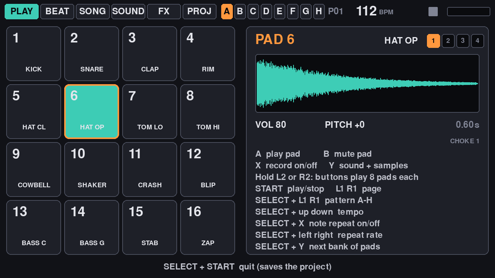

# PocketPads

A 64-pad sample sequencer and sampler (four banks of sixteen pads) for Linux handhelds, built for the TrimUI Smart Pro running [KNULLI](https://knulli.org). Put sounds on pads, tap out a beat, chop a recording, and build it into patterns, all from the gamepad.




**Status: early (version 0.03).** It has been tested on exactly one device, a TrimUI Smart Pro on KNULLI Scarab. Expect rough edges, and expect project files to change format.

## Features

- 64 pads in four banks of sixteen, a step grid of 16 to 128 steps with accents and a note per step, eight patterns, sixteen project slots
- Song mode: chain patterns in order, copy and clear patterns
- Lo-fi per pad (bit crush, sample-rate reduction) and a master compressor
- Export the song or pattern as a WAV file
- MIDI through the ALSA sequencer: controllers play pads and turn knobs; pads send notes, clock, start and stop (new, not yet tried with real hardware)
- Per pad: volume, pitch and fine tune, one-knob filter, trim, fades, reverse, choke group, delay and reverb sends, and one-shot, hold or loop play modes
- Note repeat, MPC-style swing (50 to 75%), and hold-to-apply stutter, tape stop and filter sweeps on the whole mix
- Sampling: record ten seconds from the built-in microphone and have it chopped onto the pads
- Chopping: at detected hits, into 4, 8 or 16 equal pieces, or live by tapping as the sample plays
- Time-stretch: change a sample's length from half to double without changing its pitch, with drum hits kept on time
- Fit a loop to the tempo by stretching (pitch kept) or repitching, spread one sound across all pads a semitone apart, resample the output to a pad
- Loads WAV directly, and MP3, FLAC, OGG, M4A, AAC, AIFF and Opus through ffmpeg
- A built-in starter kit that is synthesized on first run, so no sample files are shipped
- The right analog stick works as a data wheel

The manual is a single static page in [`site/`](site/index.html).

## Install on a TrimUI Smart Pro (KNULLI)

1. Copy the `pocketpads/` folder to `/userdata/roms/ports/pocketpads/`.
2. Copy `pocketpads/PocketPads.sh` to `/userdata/roms/ports/PocketPads.sh`.
3. PocketPads needs NumPy, which KNULLI does not include. Put an aarch64 build of NumPy for the device's Python (3.12 on KNULLI Scarab) in `/userdata/roms/ports/pocketpads/_vendor/`. The launcher adds that folder to the Python path.
4. Refresh the game list. PocketPads appears under Ports.

`ffmpeg` (for MP3 and other compressed formats) and `arecord` (for the microphone) are already part of KNULLI.

## Run on a computer

```
pip install -r requirements.txt
PP_WINDOW=1280x720 python pocketpads/main.py
```

Keys: arrows for the D-pad, Z = A, X = B, S = X, A = Y, Q and W = L1 and R1, 1 and 2 = L2 and R2, Return = START, Tab = SELECT. Button names follow the labels printed on the handheld (Nintendo layout).

Environment variables:

| Variable | Purpose |
|---|---|
| `PP_WINDOW=WxH` | Run in a window of that size instead of full screen |
| `PP_NOAUDIO=1` | Do not open an audio device |
| `PP_NOMIDI=1` | Do not open MIDI |
| `PP_REC_DEVICE` | ALSA capture device for recording (default `hw:0,0`, the Smart Pro's microphone) |
| `PP_GB_DIR` | Folder of a GrainBrick install to link to |
| `PP_SCRIPT=file` | Play back a script of button presses, for testing (see `load_script` in `main.py`) |

## Other devices

Nothing but the Smart Pro has been tried. The parts most likely to need changes elsewhere are the recording device and the mixer settings applied before recording (`start_record` in `main.py`), the controller button mapping (`PAD_BUTTONS`), and the 1280x720 layout, which scales but was only designed for 16:9. Reports and patches for other handhelds are welcome.

## Working with GrainBrick

[GrainBrick](https://github.com/ETRNLIAM/GrainBrick) is a separate granular instrument by another author. If it is installed in the same Ports folder, PocketPads can browse its recordings, import the slice points from its projects, and hop over to it and back. PocketPads only reads files GrainBrick has saved. It contains none of GrainBrick's code and is not affiliated with it.

## Code layout

| Path | What it is |
|---|---|
| `pocketpads/engine.py` | The sound engine: pads, sequencer, effects, WAV reading and writing, project files. No pygame. |
| `pocketpads/main.py` | Screens, input and everything the user touches |
| `pocketpads/midi.py` | MIDI in and out through the ALSA sequencer (ctypes, no extra packages) |
| `pocketpads/kit.py` | Synthesizes the starter kit and the demo beat |
| `pocketpads/art/` | The artwork and the script that draws it |
| `pocketpads/tests/` | Engine tests |
| `site/` | The manual |

## Tests

The tests cover the engine and need only NumPy:

```
for t in engine effects sampler robustness; do python pocketpads/tests/test_$t.py pocketpads; done
```

Each prints a line ending in `OK` when it passes.

## Known limits

- Changing a pad setting re-renders that pad's audio; on samples longer than a few seconds this waits until you stop adjusting.
- Converting a long MP3 pauses the screen until it finishes.
- Stretch works on samples up to 30 seconds and pauses briefly while it renders (about 0.16 s per second of audio on the Smart Pro).
- MIDI has not been tried with real controllers yet, and Bluetooth MIDI devices are not connected automatically.
- Projects are numbered, not named.

## Contributing

See [CONTRIBUTING.md](CONTRIBUTING.md).

## Licence

MIT, see [LICENSE](LICENSE). The manual's typeface, Bricolage Grotesque, is under the SIL Open Font License (`site/fonts/OFL.txt`).
