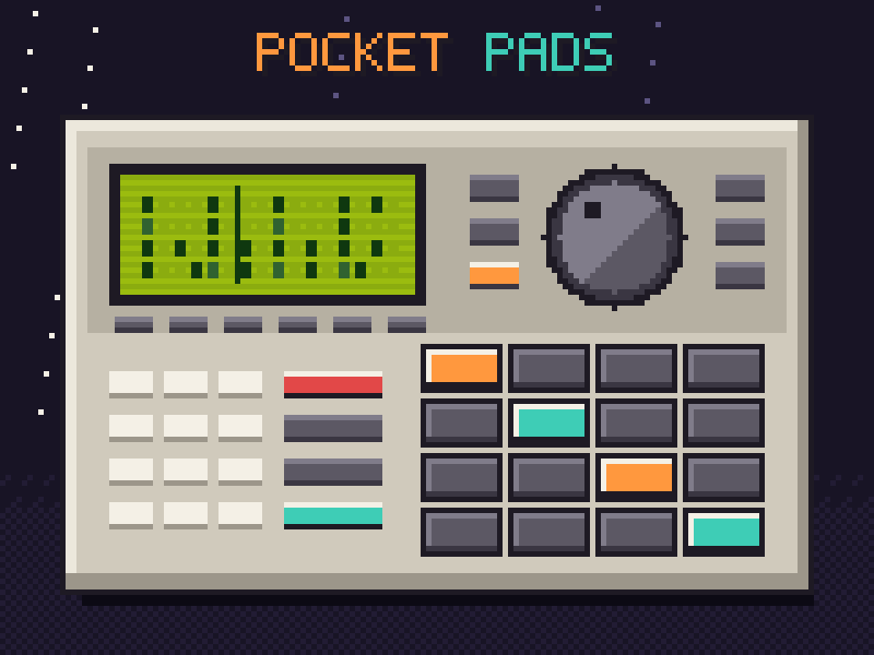

# PocketPads

A 64-pad sample sequencer and sampler (four banks of sixteen pads) for Linux handhelds, built for the TrimUI Smart Pro running [KNULLI](https://knulli.org). Put sounds on pads, tap out a beat, chop a recording, and build it into patterns, all from the gamepad.




**Status: early (version 0.5).** It has been tested on exactly one device, a TrimUI Smart Pro on KNULLI Scarab. Expect rough edges, and expect project files to change format.

## Features

- 64 pads in four banks of sixteen, a step grid of 16 to 128 steps with accents and a note per step, eight patterns, sixteen project slots that can be named
- Song mode: chain patterns in order, copy and clear patterns
- Lo-fi per pad (bit crush, sample-rate reduction) and a master compressor
- Analog sticks play performance effects (filter, tempo bend, fade, echo, reverb, stutter, crush, pan, tape stop), with the effect for each direction chosen on the FX page
- Export the song or pattern as a WAV file
- MIDI through the ALSA sequencer: a controller's pads and keys play the bank of pads on screen, its knobs turn settings you choose (MIDI KNOBS on the PROJ page) and its transport buttons run the beat, with defaults for the M-Vave SMC-PAD; pads send notes, clock, start and stop (new; tried with one USB controller's pads and an M-Vave SMC-PAD over Bluetooth)
- An M-Vave SMC-PAD connected over Bluetooth flashes its pads white as their sounds play, from the beat, the handheld or the pad. This uses the pad's own settings channel, not MIDI (protocol worked out by [spectalive/smc-pad](https://github.com/spectalive/smc-pad)); its saved colours are left alone.
- Per pad: volume, pitch and fine tune, one-knob filter, trim, fades, reverse, choke group, delay and reverb sends, and one-shot, hold or loop play modes
- Note repeat, MPC-style swing (50 to 75%), and hold-to-apply stutter, tape stop and filter sweeps on the whole mix
- Sampling: record ten seconds from the built-in microphone and have it chopped onto the pads
- Chopping: at detected hits, into 4, 8 or 16 equal pieces, or live by tapping as the sample plays
- Time-stretch: change a sample's length from half to double without changing its pitch, with drum hits kept on time
- Fit a loop to the tempo by stretching (pitch kept) or repitching, spread one sound across all pads a semitone apart, resample the output to a pad
- Loads WAV directly, and MP3, FLAC, OGG, M4A, AAC, AIFF and Opus through ffmpeg
- A built-in starter kit that is synthesized on first run, so the app itself ships no sample files
- Optional sounds in [`packs/`](packs/README.md): six generated kits and a set of 204 public-domain (CC0) recordings; install the ones you want
- The sample browser plays a file before you pick it, and loads a whole folder onto the sixteen pads in one go
- "In the beat" in the sample browser: the file you are on stands in for the pad, so the running pattern plays it before you choose
- On the BEAT page, one press left past step 1 selects the row's name, where A picks a new sound for that pad and a panel shows its waveform
- Chords: a CHORD setting makes one pad play its sound as a major, minor, 7th or other chord, and KEY CHORDS puts the chords of a major or minor key on the sixteen pads
- PROJ page: SAVE always saves the open project, SAVE A COPY starts a copy in the first empty slot, OPEN lists the saved projects
- Four style starters (ambient, techno, house, hip hop), each a synthesized kit of sixteen sounds, seven or eight patterns and a full song chaining them; pick one under NEW on the PROJ page
- The right analog stick works as a data wheel on the SOUND and PROJ pages
- On the BEAT page the left stick changes the tempo and the right stick the selected pad's volume

The manual is in [`site/`](site/index.html): an overview page, and a [full guide](site/guide.html) with tutorials, how to manage projects and sounds, and a reference for every setting.

## What's new in 0.5

- **Bluetooth MIDI.** Bluetooth controllers connect by themselves when PocketPads starts, with nothing to pair in the system menu. A BLUETOOTH MIDI row on the PROJ page searches again.
- **Knobs you can map.** A MIDI KNOBS list on the PROJ page chooses what each of sixteen controller knobs changes: a setting of the selected pad, or tempo, master volume, swing, compressor, delay feedback or reverb size.
- **M-Vave SMC-PAD set up from the start.** Its knobs, knob bank, play, stop, pause, record, `<<` and `>>` and pad bank work as they come, with the numbers read from a real unit. The SMC-PAD Pocket's pads work too.
- **Pad 1 is at the bottom left.** The PLAY grid is numbered like pad controllers, pad 1 bottom left and pad 16 top right, so the pad you hit is the pad that lights up.
- Controller transport buttons run the beat, and note repeat works from a controller's pads.
- The guide has a controller reference with drawings of both M-Vave pads.

## What's new in 0.4

- **Performance fixes.** The screen now redraws only the areas that change instead of the whole picture every frame. On the Smart Pro this roughly halves the drawing work on the PLAY and BEAT pages while a beat plays (about 29 ms down to 14 ms of each 33 ms frame on the step grid), which removes the slow-down and crackle that drawing caused by crowding out the audio.
- **Smoother stick effects.** Filter, echo, reverb and stutter glide between values, so fast stick moves no longer crackle.
- Stick performance effects on the FX page, with the effect for each stick direction chosen by you.
- Song mode, eight patterns of 16 to 128 steps, a note per step, row painting, four pad banks (64 pads).
- Lo-fi per pad, a master compressor, WAV export, MIDI in and out.
- NEW starts a project in the next empty slot and keeps the open one.

## Install on a TrimUI Smart Pro (KNULLI)

1. Copy the `pocketpads/` folder to `/userdata/roms/ports/pocketpads/`.
2. Copy `pocketpads/PocketPads.sh` to `/userdata/roms/ports/PocketPads.sh`.
3. PocketPads needs NumPy, which KNULLI does not include. Put an aarch64 build of NumPy for the device's Python (3.12 on KNULLI Scarab) in `/userdata/roms/ports/pocketpads/_vendor/`. The launcher adds that folder to the Python path.
4. Refresh the game list. PocketPads appears under Ports.

`ffmpeg` (for MP3 and other compressed formats) and `arecord` (for the microphone) are already part of KNULLI.

More sounds are optional: see [`packs/`](packs/README.md) for what there is and how to add it.

## Run on a computer

```
pip install -r requirements.txt
PP_WINDOW=1280x720 python pocketpads/main.py
```

Keys: arrows for the D-pad, Z = A, X = B, S = X, A = Y, Q and W = L1 and R1, 1 and 2 = L2 and R2, Return = START, Tab = SELECT. Button names follow the labels printed on the handheld (Nintendo layout).

Environment variables:

| Variable | Purpose |
|---|---|
| `PP_WINDOW=WxH` | Run in a window of that size instead of full screen |
| `PP_NOAUDIO=1` | Do not open an audio device |
| `PP_NOMIDI=1` | Do not open MIDI |
| `PP_REC_DEVICE` | ALSA capture device for recording (default `hw:0,0`, the Smart Pro's microphone) |
| `PP_GB_DIR` | Folder of a GrainBrick install to link to |
| `PP_SCRIPT=file` | Play back a script of button presses, for testing (see `load_script` in `main.py`) |

## Other devices

Nothing but the Smart Pro has been tried. The parts most likely to need changes elsewhere are the recording device and the mixer settings applied before recording (`start_record` in `main.py`), the controller button mapping (`PAD_BUTTONS`), and the 1280x720 layout, which scales but was only designed for 16:9. Reports and patches for other handhelds are welcome.

## Working with GrainBrick

[GrainBrick](https://github.com/ETRNLIAM/GrainBrick) is a separate granular instrument by another author. If it is installed in the same Ports folder, PocketPads can browse its recordings, import the slice points from its projects, and hop over to it and back. PocketPads only reads files GrainBrick has saved. It contains none of GrainBrick's code and is not affiliated with it.

## Code layout

| Path | What it is |
|---|---|
| `pocketpads/engine.py` | The sound engine: pads, sequencer, effects, WAV reading and writing, project files. No pygame. |
| `pocketpads/main.py` | Screens, input and everything the user touches |
| `pocketpads/midi.py` | MIDI in and out through the ALSA sequencer (ctypes, no extra packages) |
| `pocketpads/kit.py` | Synthesizes the starter kit and the demo beat |
| `pocketpads/styles.py` | The style starters: their sounds, patterns (written as text) and songs |
| `pocketpads/art/` | The artwork and the script that draws it |
| `pocketpads/tests/` | Engine tests |
| `packs/` | Optional sounds, and the script that makes the generated ones |
| `site/` | The manual |

## Tests

The tests cover the engine and need only NumPy, except `midi`, which runs the whole app without a screen and also needs pygame:

```
for t in engine effects sampler robustness styles midi; do python pocketpads/tests/test_$t.py pocketpads; done
```

Each prints a line ending in `OK` when it passes.

## Known limits

- Changing a pad setting re-renders that pad's audio; on samples longer than a few seconds this waits until you stop adjusting.
- Converting a long MP3 pauses the screen until it finishes.
- Stretch works on samples up to 30 seconds and pauses briefly while it renders (about 0.16 s per second of audio on the Smart Pro).
- MIDI in has been tried with one USB controller, and only its pads, and with an M-Vave SMC-PAD over Bluetooth (pads, knobs, transport and bank buttons); MIDI out and clock have not been tried with real gear. Bluetooth MIDI controllers connect by themselves (PocketPads reads them through BlueZ, which needs the system's `dbus` Python module), in only: notes and clock out go to USB devices.
- Pad lights work on the full-size SMC-PAD over Bluetooth only: not over USB, and not on the SMC-PAD Pocket, which has not been tried.
- An export is five minutes at most.
- The MIDI clock is timed by the system clock, not the sound card, so gear synced to it can drift over a long song.

## Contributing

See [CONTRIBUTING.md](CONTRIBUTING.md).

## Licence

MIT, see [LICENSE](LICENSE). The manual's typeface, Bricolage Grotesque, is under the SIL Open Font License (`site/fonts/OFL.txt`).
